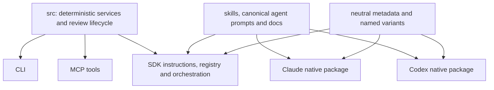

# Harness-agnostic core with thin native adapters

## Problem Statement

flight-rules is installed as a Claude Code plugin. Its deterministic operations and policy should also serve Codex and programmatic agents, without independently authored copies of skills or prompts drifting between consumers.

## Solution

Author policy, skills and agent prompts once. Publish deterministic TypeScript as a library; keep the CLI as an adapter. Generate native host registrations and packages from neutral agent metadata, and implement a small shared orchestration vocabulary through each host's runtime.

The source of truth is independent of every host:

- `src/`: deterministic operations, validation, context and lifecycle rules.
- `skills/*/SKILL.md`: canonical skill instructions, placed unchanged in host targets.
- `agents/*.md`: canonical prompt bodies with strict neutral frontmatter.
- `agents/variants.json`: metadata-only named tier variants sharing canonical prompts.
- `docs/*.md`: shared methods, charters and contracts, resolved through the library or `flight-rules doc`.
- `adapters/<host>/`: reviewed host bindings, including concrete model choices.

Use native installation paths for Claude and Codex. The SDK imports the core in process; neither an SDK adapter nor MCP shells out to this package's own CLI. Adding a host changes an emitter and runtime binding, not a canonical prompt.

## Delivery status — 2026-10-13

| Epic | State | Remaining delivery |
| --- | --- | --- |
| [E1 #166](https://github.com/Good-Ground-Collective/flight-rules/issues/166) | Complete | Core factory, library exports, neutral schema/parser, install-relative docs and config fallback shipped |
| [E2 #167](https://github.com/Good-Ground-Collective/flight-rules/issues/167) | Complete | Neutral sources, named variants and native Claude bridge shipped in #236 / v1.69.0, with live role smoke evidence |
| [E3 #168](https://github.com/Good-Ground-Collective/flight-rules/issues/168) | Complete | Native Claude/Codex packages and release-owned artifacts shipped through v1.73.0; published Git/npm artifacts validated |
| [E4 #169](https://github.com/Good-Ground-Collective/flight-rules/issues/169) | In progress | Shared contract #243, skill integration and bounded fan-out #95, then permission preflight #94 |
| [E5 #170](https://github.com/Good-Ground-Collective/flight-rules/issues/170) | Planned | Cross-target drift checks, native setup and scratch-repository execution proof |
| [E6 #171](https://github.com/Good-Ground-Collective/flight-rules/issues/171) | Planned | MCP and SDK adapters with one reference harness |

The shared iterative review work ([#220](https://github.com/Good-Ground-Collective/flight-rules/issues/220), merged [#225](https://github.com/Good-Ground-Collective/flight-rules/pull/225)) provides another completed core consumer surface. Version 1.67.0 publishes the root library, `./review`, full/transport review schemas, docs and CLI to GitHub Packages. [tlp-actions#37](https://github.com/think-lp/tlp-actions/pull/37) consumes that package; #39 adds charter-based comprehensive review. No MCP or SDK adapter is required to make that existing integration work.

The earlier portability umbrella [#87](https://github.com/Good-Ground-Collective/flight-rules/issues/87) remains historical tracking. Its remaining tickets now belong to E2–E5; do not maintain a separate implementation plan there. Language-specific charters [#226](https://github.com/Good-Ground-Collective/flight-rules/issues/226) are a separate initiative and can continue without a host-portability rewrite.

## Technical Notes

### Deterministic core and native adapters

The public package is `@good-ground-collective/flight-rules`. The root export supplies typed services and `createFlightRules`; `./review` supplies canonical policy/context loading, strict contracts, evidence verification, lifecycle planning and durable marker encoding. Consumer adapters gather facts, invoke the model and persist results. Approval policy remains the consumer's responsibility.

Existing build outputs are the bundled CLI, an external-dependency ESM library, the review entry, declaration files and review JSON schemas. Preserve their exports and packed-install behavior when expanding the build. The package is already published: E3 owns native target assembly and generated-artifact ownership, not first publication.



### Neutral agent sources

Capabilities are `read`, `edit`, `shell`, `web`, `spawn` and `ask`. Model tiers are `standard`, `escalated` and `expert`; expert remains unused and requires a recorded rationale when adopted. Unknown metadata keys fail validation. Concrete tools and models belong in adapter mappings; retained display color belongs in `x-claude`.

Five canonical prompts resolve into seven named registrations. `code-implementation-escalated` shares the implementation prompt and selects escalated tier. `qa-engineer-verify` shares the QA prompt and selects standard tier. Variants never author another prompt or widen capabilities.

The implementation loop dispatches the standard implementer twice and the escalated implementer only on the final attempt after two verifier rejections. The verifier stays standard. QA verification and reproduction select named registrations. The caller does not override models at dispatch. See [agent-contract](../docs/agent-contract.md) for metadata, bindings and invariants.

A capability declaration does not enforce a sandbox or authorize external mutations. Adapters must handle unsupported settings explicitly; they cannot silently weaken required restrictions. Worker agents return questions/missing inputs to their caller. Orchestrating skills own dispatch and human stop-and-wait points.

### Orchestration contract

E4 formalizes the existing vocabulary in [orchestration-interface](../docs/orchestration-interface.md), with importable validation and retry policy:

```text
dispatch(agent, brief) -> structured report
dispatchMany(briefs, { maxConcurrent }) -> reports, batched above the bound
ask(question) -> actual human answer before dependent work
limits -> adapter concurrency and nesting constraints
```

The contract also covers invocation of sibling skills and caller-context propagation. Implementation retries, concurrent threads and nesting depth are distinct limits. Sequential wave execution stays sequential. Reproduction and verification retain unattended behavior; planning/configuration discovery retain their authorized stop-and-wait points.

Required git, network and dispatch capabilities are checked before the first mutation. Failures name the missing capability and a host-specific remedy. Permission preflight cannot grant additional access on its own.

### Native packaging and installation

E2 includes a minimal Claude registration bridge so neutralizing source files does not break the current plugin. It emits native agent markdown into `dist/claude/agents`, updates the existing manifest and makes those registrations release artifacts. Skills, docs and the CLI retain their current layout during this bridge.

E3 expands the emitters into complete `dist/claude` and `dist/codex` targets and moves generated artifacts out of ordinary developer commits. Release must preserve the CLI shim, stamp every relevant manifest, build all outputs and publish a complete package. E5 then verifies discovery, setup and the full pipeline after native installation in a scratch repository.

Host formats, plugin components, model access and limits change. Verify them against current official documentation and the installed host while implementing each adapter. The September inventory's fixed version, five-agent count and assumed concurrency defaults are not implementation guarantees. Native setup/settings integration is still required; the current settings backend is Claude-specific even though the config-file fallback is neutral.

### MCP and SDK

MCP and SDK adapters are independent and gate no native-host work. MCP exposes the same validated inputs and core operations as the CLI. Commander metadata can supply names/options, but handlers and results must use the same service contracts; metadata alone does not provide executable semantics.

The SDK surface loads canonical skills, resolves all named registrations and provides orchestration/report types. One chosen harness supplies a working reference implementation. A conversational DeepAgent reviewer is a candidate consumer, not the neutral interface itself. Reuse `./review` for its policy and lifecycle.

Keep one package while that remains practical. Measure provider dependency growth before proposing a workspace split; any split must preserve the existing root and review import contracts.

## Delivery order and proof

1. Complete E2, preserving the existing Claude plugin throughout the source migration.
2. Complete E3 and E4 after E2; packaging and orchestration can progress independently.
3. Complete E5 after both: same sources installed natively, implementation/verification retry, and a human decision boundary exercised on each host.
4. Complete E6 with one real SDK reference consumer and optional MCP tools.

Use autonomous review as an early shared-policy consumer proof, then `execute-work` as the orchestration proof. Deterministic tests establish contract and artifact consistency; live host runs establish actual model/tool behavior. Record both without implying one proves the other.

Success means one source edit reaches every target, both native hosts complete the planned workflow, and an SDK consumer can import instructions and deterministic operations without re-authoring policy.
